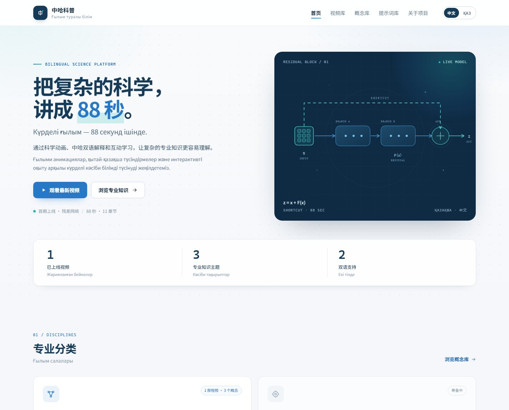
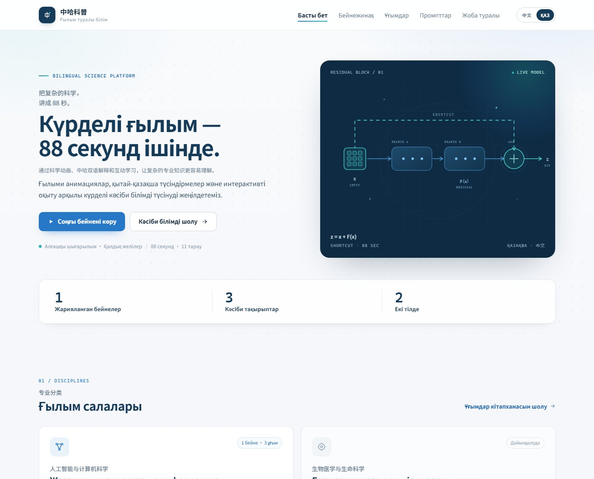

# 中哈科普 · 现代科学知识与双语学习平台

一个**纯静态**的中哈双语科普站：每部短片配一段中文 / 哈萨克语概念解释，以及一份可以复现它的生成提示词。视觉定位为 **Modern Scientific Editorial Platform**——用编辑设计、清晰的信息层级与克制的动效，把科学内容做得专业、耐读、可反复使用。

> 仓库名使用拼音 `zhong-ha`：GitHub 的仓库名只接受 ASCII 字符，中文「中哈」会被规范化，因此以拼音命名，站点与项目名仍为「中哈科普」。

首期内容：《残差网络：为什么网络越深，反而更难训练？》——88 秒中英字幕动画 + 中文/哈萨克语概念页 + 90 秒版完整制作提示词。

| 中文界面 | Қазақша интерфейс |
| --- | --- |
|  |  |

## 在线访问

- 站点：`https://hawkplus.github.io/zhong-ha/`
- 仓库：`https://github.com/Hawkplus/zhong-ha`

## 页面

| 页面 | 说明 |
| --- | --- |
| `index.html` | 首页：品牌 Hero、真实数据、四个专业分类、最新视频、精选概念、提示词入口 |
| `videos/resnet.html` | 残差网络视频页：播放器、四阶段知识结构、原理 SVG、11 个时间章节、双语解释 |
| `concepts.html` | 概念库：退化现象、残差连接、梯度通路——中文 / 哈萨克语对照 |
| `prompts.html` | 提示词库：两份完整提示词，支持一键复制与 Markdown 下载 |
| `about.html` | 项目说明、双语说明、四步新增视频方法、技术说明 |

## 设计系统

- **色彩**：背景 `#F5F7FA`，卡片 `#FFFFFF`，主文字 `#142B40`，品牌深蓝 `#153B59`，科技蓝 `#2878C8`，辅助青 `#28B6B0`，浅蓝 `#EAF3FA`，边框 `#E2EAF0`。
- **字体**：中文优先 Noto Sans SC / Microsoft YaHei，哈萨克语与西文优先 Inter / Noto Sans；全站使用系统字体栈，无外部字体请求。
- **版式**：最大内容宽度 1240px，8px 间距体系，卡片圆角 12–18px，按钮圆角 8–12px，正文 14.5–16px，区域标题 26–31px。
- **组件**：统一的按钮、分类卡片、视频精选卡、概念卡、双语知识块、数据条目与代码区；不在每张卡片上堆叠标签和装饰。
- **界面语言**：右上角是 **中文 / ҚАЗ** 分段切换。切换后导航、按钮、元信息与标题主次会变为哈萨克语优先，双语正文改为哈萨克语左栏优先；正文保留中哈对照，不隐藏任一语言。选择写入 `localStorage`，刷新与跨页保持；无 JS 时开关隐藏，页面保持默认中文。
- **动效**：参考 React Bits 的交互思路，用零依赖原生 JS 重写——Hero 交互点阵（Canvas）、标题逐字模糊入场（BlurText）、统计数字滚动（CountUp）、滚动揭示（AnimatedContent）、卡片光斑（SpotlightCard）、短标签解码（DecryptedText）、Canvas 火花（ClickSpark）、阅读进度与回到顶部。所有动效遵循 `prefers-reduced-motion`，禁用 JS 时内容仍完整可见。

## 数据

`assets/js/data.js` 是统计数据的单一来源：首页的已上线视频、专业知识主题、双语支持数量，以及分类卡片的「1 部视频 · 3 个概念」都由它驱动。筹备中的分类不计数。

## 技术

- 纯 HTML / CSS / 原生 JavaScript，无框架、无构建、无外部字体与统计脚本。
- 视频使用浏览器原生 `<video>` 播放；复制、收藏、章节跳转、点击粒子均为渐进增强，禁用 JS 后正文与播放仍然可用。
- 语言偏好保存在 `localStorage`（`zhongha:lang`），不改变 URL；无 JS 时隐藏语言开关。
- 托管在 GitHub Pages，`.nojekyll` 保证静态文件原样发布。

## 目录

```text
.
├── index.html
├── concepts.html
├── prompts.html
├── about.html
├── 404.html
├── videos/
│   └── resnet.html
├── assets/
│   ├── css/site.css        # Design System + 响应式
│   ├── js/site.js          # 导航 / 复制 / 章节 / 收藏
│   ├── js/lang.js          # 中文 / Қазақша 界面切换
│   ├── js/motion.js        # BlurText / CountUp / 点阵 / 光斑 / 火花 / 进度
│   ├── js/data.js          # 真实内容数据
│   ├── img/                # 封面、关键帧、分享图、favicon
│   ├── videos/             # resnet-88s.mp4
│   └── prompts/            # 提示词 Markdown 原文
├── docs/
│   ├── preview-lang-zh.jpg
│   └── preview-lang-kk.jpg
├── .nojekyll
└── README.md
```

## 本地预览

直接双击 `index.html` 即可；视频与提示词使用相对路径，离线也能播放。

如需以 HTTP 方式预览（推荐，便于测试复制到剪贴板等功能）：

```bash
python -m http.server 8000
# 打开 http://localhost:8000/
```

## 如何新增一部视频

1. **准备素材**：`.mp4`（H.264 / yuv420p，16:9）、16:9 封面、每 8 秒一张章节缩略图。
2. **放入目录**：视频 → `assets/videos/`；封面与缩略图 → `assets/img/`；提示词 → `assets/prompts/`。文件名使用英文小写与连字符。
3. **复制页面**：`videos/resnet.html` → `videos/<slug>.html`，替换标题、哈萨克语标题、正文、章节按钮（`data-chapter` 为跳转秒数）和素材路径。
4. **更新首页**：更新「最新视频」区域，并从「后续选题」删除对应条目；在 `assets/js/data.js` 中更新已上线数量与分类计数。

> `videos/` 下的页面引用素材时使用 `../assets/`；首页、`concepts.html`、`prompts.html` 使用 `assets/`。

## 说明

- 视频、封面与插图由项目作者使用 AI 工具生成、剪辑与校对；内容用于科普学习，不构成专业结论。
- 哈萨克语文本为教学初稿，以准确传达概念为目标，欢迎在 Issue 中指正术语与表达。
- 概念内容参考：He, Zhang, Ren, Sun. *Deep Residual Learning for Image Recognition*. arXiv:1512.03385, 2015.
- 转载或复用内容请注明出处。
